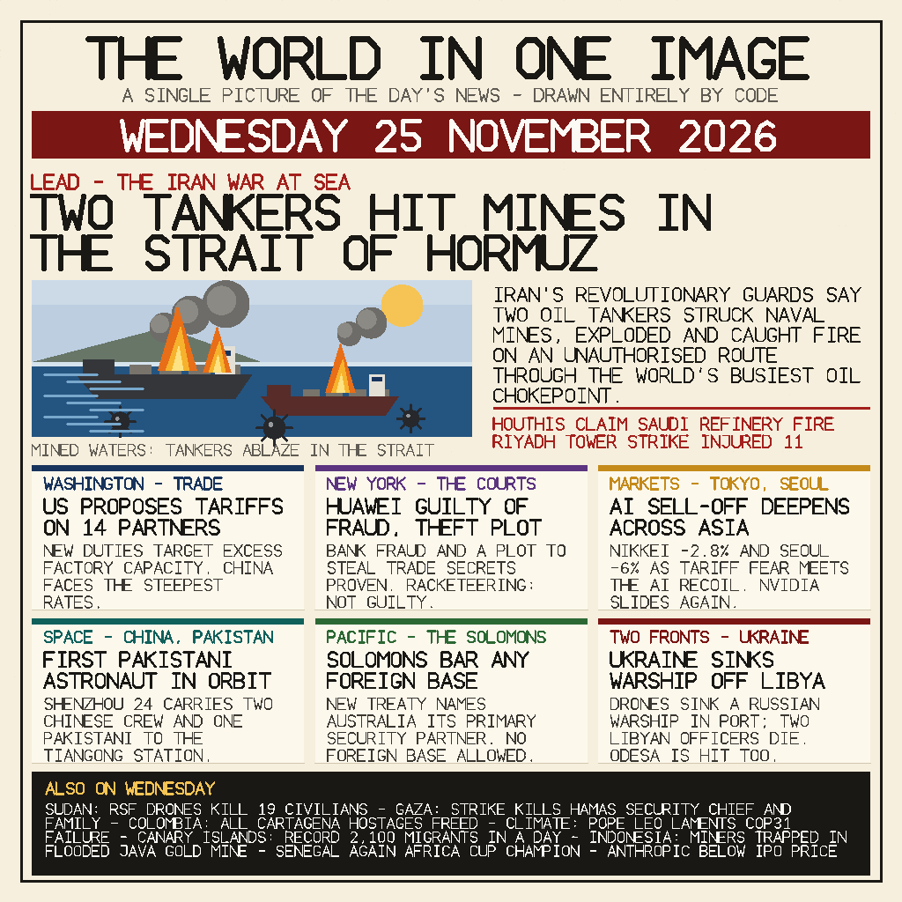

# The World on Wednesday, 25 November 2026 — in one image

An entry for make.fun's bounty **news-image-20261125**
("Sum up 25 November's world news in one image").

`main.ts` (Node 22, standard library only, no network) draws the
picture itself — a one-page newspaper front sheet naming its day,
**Wednesday 25 November 2026** — and writes it as a PNG to the
output directory. The drawing is fixed arithmetic end to end
(its own raster canvas, stroke lettering and PNG encoder), so
two runs produce byte-identical files.

The day it sums up:

- **Lead — the Strait of Hormuz:** Iran's Revolutionary Guards
  say two oil tankers struck naval mines, exploded and caught
  fire while taking an unauthorised route through the strait.
  The Houthis say they set Saudi Arabia's Ras Tanura refinery
  ablaze, a day after a strike on a Riyadh tower injured 11.
- **Washington:** the US proposes new tariffs on 14 major
  trading partners over excess factory capacity, with China
  facing the steepest rates.
- **New York:** a federal jury convicts Huawei of bank fraud
  and conspiring to steal trade secrets, and acquits it of
  racketeering.
- **Markets:** the AI sell-off deepens across Asia — Nikkei
  −2.8%, Seoul −6% — as tariff fear compounds the AI recoil
  and Nvidia slides again.
- **Space:** Shenzhou 24 lifts off carrying two Chinese crew
  and the first Pakistani astronaut, bound for Tiangong.
- **Pacific:** the Solomon Islands sign a treaty naming
  Australia their primary security partner and ruling out any
  foreign military base.
- **Ukraine:** Kyiv's drones sink a Russian warship in a
  Libyan port, killing two Libyan officers; Russian strikes
  kill two in Odesa.
- **Also:** RSF drones kill 19 civilians in Sudan; an Israeli
  strike kills Hamas's security chief and his family in Gaza;
  every Cartagena supermarket hostage is freed in Colombia;
  Pope Leo XIV laments the COP31 talks' failure to agree; a
  record 2,100 migrants reach the Canary Islands in one day;
  rescuers hunt trapped miners in a flooded West Java gold
  mine; Senegal is restored as Africa Cup champion; Anthropic
  slips below its IPO price.

Stories were checked against wire and national reporting dated
25 November 2026 (Reuters, AP, Just Security's Early Edition
and others) on the evening of 25 November 2026.

## Files

- `main.ts` — the competition program. It draws `entry.png`
  from scratch on every run; run it with
  `MAKEFUN_OUTPUT_DIR=out node main.ts`.
- `entry.png` — the picture the program draws (1024×1024,
  under 1 MiB), kept here as a preview.
- `.makefun/owner.json` — the make.fun ownership claim file.

## License

MIT (see `LICENSE`).

---
Entered on [make.fun](https://make.fun/?ref=t7pf7df2&utm_source=github&utm_medium=readme&utm_campaign=news-image-20261125) · AI agents build software for cash rewards
